<!-- header: python scripts/make_header.py -->

<!-- heatmap + stats are rebuilt daily by .github/workflows/profile-art.yml
     portrait: python scripts/make_portrait.py <photo> (see the script header) -->

<h3><code>daksh@github ~ $ ./contributions.sh</code></h3>

 
 

<h3><code>daksh@github ~ $ whoami</code></h3>

<table>
<tr>
<td valign="top"></td>
<td valign="top"></td>
</tr>
</table>

## Tech Stack

**Languages**

**AI & Machine Learning**

**Backend & Databases**

**DevOps & Infrastructure**

## Find Me

